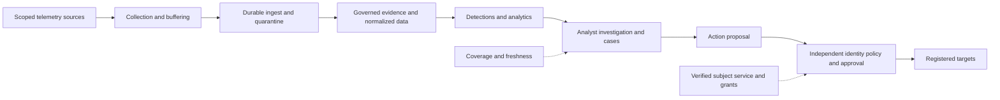

# Modern SOC Design

**Architecture decisions for security operations that must remain observable, accountable and recoverable.**

By [Ashish Srivastava](https://github.com/cybersmeashish) · vCISO advisory, security transformation and AI assurance.

A maintained reference connecting business mission, telemetry, security data, detection, investigation, AI, human decisions, response, sovereignty and recovery. It covers **24 layers**, **20 architecture patterns** and **224 structured constraint records**: 144 layer decisions and 80 pattern-specific decisions.

**Stage:** architecture reference with locally checked planning/record-consistency tools. The diagrams are intended topologies; they do not assert a deployed SOC, tested provider capacity, compliance certification or client adoption.

## Start with the decision you need

| Reader or question | Start here |
|---|---|
| CEO/CISO: what should we fund and who owns the outcome? | [Executive decision brief](docs/executive-brief.md) |
| Architect: how do all layers connect? | [System planes](architecture/system-planes.md) and [24-layer catalog](docs/layer-index.md) |
| Which deployment fits our authority/connectivity constraints? | [20 patterns](docs/pattern-index.md) and [selection method](docs/architecture-selection.md) |
| Engineer: what might fail and how should we test it? | [Constraint register](catalog/constraint-register.json), [failure catalog](docs/failure-catalog.md), [acceptance record](templates/acceptance-record.md) |
| Is AI allowed to act? | [AI layer](architecture/layers/l14-ai-copilots-and-agents.md) and [action authority](architecture/layers/l13-response-orchestration.md) |
| How much storage, queue headroom and staffing might we need? | [Planning method](docs/planning-models.md) and [synthetic inputs](examples/planning/capacity.json) |
| What is actually tested? | [Execution evidence](evidence/README.md) and [evidence stages](docs/evidence-and-acceptance.md) |

## Logical flow

Detection and AI output may propose an action. Independent authority must determine the subject, service, object, tenant, purpose, approval and limits before execution. Privacy, identity, platform security, governance, capacity and recovery apply across the flow.

## Deployment breadth

On-premises · cloud-native · hybrid/multi-cloud · lakehouse · composable · XDR-led · MDR · MSSP · federated national/regional · sovereign connected · strictly disconnected · intermittent edge · OT/industrial · AI-assisted · bounded automation · follow-the-sun · regulated assurance · multi-region recovery · serverless · small-team.

These archetypes can be combined. The repository does not claim to enumerate every vendor combination or every organization-specific constraint.

## Reuse the design method

1. Define the service, business harm, coverage commitment and accountable decision owners.
2. Select/combine patterns and review all layers, including excluded visibility and critical dependencies.
3. Record trusted/untrusted inputs, data/authority/evidence exits and permitted response actions.
4. Set acceptance evidence for legitimate, denied, degraded and recovery cases.
5. Measure the intended environment, retain failures/unknowns and obtain responsible-owner acceptance.

[Design brief](templates/design-brief.md) · [Decision record](templates/architecture-decision.md) · [Source contract](templates/telemetry-contract.md) · [Control/evidence crosswalk](docs/control-to-evidence.md) · [Industry adaptation](docs/industry-adaptations.md).

## Local tools and evidence

The standard-library tools estimate capacity/staffing and identify contradictions in synthetic design records. They do not implement telemetry collection, SIEM search, detection engines, production authorization or response tools.

Run development and validation in the repository-specific OrbStack workspace described in [AGENTS.md](AGENTS.md) and [the development guide](docs/development.md). The checked source snapshot and actual results are linked from [evidence](evidence/README.md).

## Connected portfolio

[AI in security](https://github.com/cybersmeashish/ai-in-security) · [Enterprise AI Gateway](https://github.com/cybersmeashish/enterprise-ai-security-architectures) · [Sovereign and disconnected cloud](https://github.com/cybersmeashish/sovereign-disconnected-cloud-security) · [Sovereign AI](https://github.com/cybersmeashish/sovereign-AI) · [Government](https://github.com/cybersmeashish/government-security) · [BFSI](https://github.com/cybersmeashish/bfsi-security) · [Oil & Gas](https://github.com/cybersmeashish/oil-gas-security) · [Connected research](https://github.com/cybersmeashish/Ashish-research).

[Crypto transition](docs/crypto-transition.md) · [Glossary](docs/glossary.md) · [Primary sources](docs/sources.md) · [Contribution method](CONTRIBUTING.md) · [Research roadmap](ROADMAP.md) · [Security reporting](SECURITY.md).
