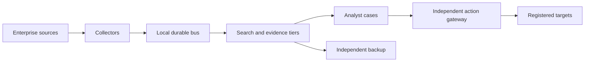

# P01 — Centralized on-premises SOC

**Stage:** reference architecture; not a tested deployment.

## When to consider it

A controlled enterprise estate with local processing and platform ownership.

## Logical arrangement

Site collectors feed a local bus and evidence platform; the response gateway reaches registered resources.

Arrows identify intended relationships. They are not packet observations, provider deployment evidence or proof of isolation.

## Trade-off

Local control brings platform, storage, skills, update and recovery obligations.

## Pattern-specific design constraints

| ID | Decision to make | Failure to avoid | Acceptance evidence |
|---|---|---|---|
| P01-C01 | Separate management, workload and evidence trust zones. | A platform compromise reaches targets and erases evidence. | Boundary review and denied management-to-target paths. |
| P01-C02 | Identify shared power, storage, time, identity and license failures. | Redundant nodes share an indispensable dependency. | Dependency failure exercise and independent recovery options. |
| P01-C03 | Size local buffers and restoration for a stated outage. | Local placement is assumed resilient without tested restoration. | Measured backlog/restore trials and declared assumptions. |
| P01-C04 | Control privileged support and update import paths. | Support or media bypasses intended local authority. | Support records and failed package-admission cases. |

## Priority layer reviews

[L04](../layers/l04-edge-collection-and-buffering.md) · [L07](../layers/l07-data-platform-and-retention.md) · [L17](../layers/l17-soc-identity-and-privileged-access.md) · [L19](../layers/l19-resilience-and-disaster-recovery.md)

All 24 layers remain in the review scope. These links highlight decisions that change most for this pattern; they do not exempt other controls.

## Environment-specific gate

Before implementation, agree the business scope, approved sources, authority boundaries, data/administrator/key/support/recovery placement, critical dependencies and response rights. Verify actual source delivery, permission boundaries, failure behavior, cost/capacity and restoration in the intended environment. Mixed patterns need an interface and responsibility review at every joining boundary.

[Pattern catalog](../../docs/pattern-index.md) · [Selection method](../../docs/architecture-selection.md) · [Acceptance record](../../templates/acceptance-record.md).
