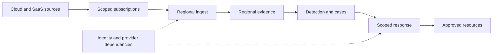

# P02 — Cloud-native SOC

**Stage:** reference architecture; not a tested deployment.

## When to consider it

Cloud-heavy services using managed event collection, storage and analytics.

## Logical arrangement

Regional subscriptions feed managed queues/data tiers; query and response identities remain separate.

Arrows identify intended relationships. They are not packet observations, provider deployment evidence or proof of isolation.

## Trade-off

Managed operations add region, API, identity, billing and supplier dependencies.

## Pattern-specific design constraints

| ID | Decision to make | Failure to avoid | Acceptance evidence |
|---|---|---|---|
| P02-C01 | Verify log enablement, delivery paths and provider API limits. | A cloud account exists while required logs are absent. | Permission checks and throttling/delivery-failure cases. |
| P02-C02 | Define storage, query, support and recovery placement independently. | A regional bucket masks foreign processing or administration. | Declared versus observed placement and supplier review. |
| P02-C03 | Include billing, licensing and account suspension in continuity. | Budget or account state stops collection or investigation. | Operating dependency review and degraded-mode decisions. |
| P02-C04 | Separate evidence access from cloud containment permissions. | Query access grants broad resource mutation. | Least-authority grants and foreign-resource denials. |

## Priority layer reviews

[L03](../layers/l03-telemetry-producers.md) · [L05](../layers/l05-ingestion-and-streaming.md) · [L07](../layers/l07-data-platform-and-retention.md) · [L20](../layers/l20-privacy-sovereignty-and-governance.md)

All 24 layers remain in the review scope. These links highlight decisions that change most for this pattern; they do not exempt other controls.

## Environment-specific gate

Before implementation, agree the business scope, approved sources, authority boundaries, data/administrator/key/support/recovery placement, critical dependencies and response rights. Verify actual source delivery, permission boundaries, failure behavior, cost/capacity and restoration in the intended environment. Mixed patterns need an interface and responsibility review at every joining boundary.

[Pattern catalog](../../docs/pattern-index.md) · [Selection method](../../docs/architecture-selection.md) · [Acceptance record](../../templates/acceptance-record.md).
