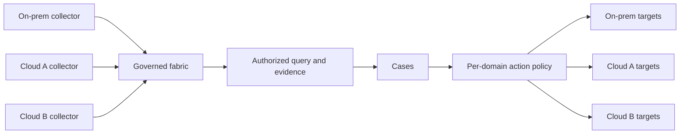

# P03 — Hybrid and multi-cloud SOC

**Stage:** reference architecture; not a tested deployment.

## When to consider it

Services spanning on-premises, several clouds and SaaS.

## Logical arrangement

Collectors join a governed fabric; shared cases retain original identity and provenance.

Arrows identify intended relationships. They are not packet observations, provider deployment evidence or proof of isolation.

## Trade-off

Coordination simplifies while identity, egress, queries and time semantics remain heterogeneous.

## Pattern-specific design constraints

| ID | Decision to make | Failure to avoid | Acceptance evidence |
|---|---|---|---|
| P03-C01 | Preserve provider/tenant-qualified identity through joins. | Equivalent names merge unrelated principals. | Cross-provider collision and scope cases. |
| P03-C02 | Decide where raw data remains and what crosses domains. | Centralization creates undocumented export. | Approved flow register and disclosure controls. |
| P03-C03 | Test normalization and queries per provider/backend. | One dashboard hides divergent meanings and missing data. | Backend-specific detection observations. |
| P03-C04 | Maintain separate action grants and failure modes per domain. | Central services inherit every administrator role. | Domain-specific allowed/denied and outage cases. |

## Priority layer reviews

[L02](../layers/l02-asset-and-risk-context.md) · [L06](../layers/l06-schema-time-and-lineage.md) · [L17](../layers/l17-soc-identity-and-privileged-access.md) · [L23](../layers/l23-interoperability-and-migration.md)

All 24 layers remain in the review scope. These links highlight decisions that change most for this pattern; they do not exempt other controls.

## Environment-specific gate

Before implementation, agree the business scope, approved sources, authority boundaries, data/administrator/key/support/recovery placement, critical dependencies and response rights. Verify actual source delivery, permission boundaries, failure behavior, cost/capacity and restoration in the intended environment. Mixed patterns need an interface and responsibility review at every joining boundary.

[Pattern catalog](../../docs/pattern-index.md) · [Selection method](../../docs/architecture-selection.md) · [Acceptance record](../../templates/acceptance-record.md).
