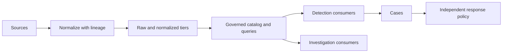

# P04 — Security data lakehouse

**Stage:** reference architecture; not a tested deployment.

## When to consider it

High-volume retention with multiple analytics consumers.

## Logical arrangement

Raw/normalized tiers serve governed query engines, detections and cases independently of action authority.

Arrows identify intended relationships. They are not packet observations, provider deployment evidence or proof of isolation.

## Trade-off

Flexible analytics adds catalog, authorization, cost and lifecycle complexity.

## Pattern-specific design constraints

| ID | Decision to make | Failure to avoid | Acceptance evidence |
|---|---|---|---|
| P04-C01 | Enforce authorization below each query/export engine. | Consumers bypass SIEM-level filters. | Direct storage/query/export denial cases. |
| P04-C02 | Handle late events, reprocessing and tier-specific lifecycle. | Late evidence is missed or deleted prematurely. | Backfill/reprocess/retention cases with lineage. |
| P04-C03 | Model duplicate tiers, indexes and query concurrency. | Cheap storage is presented as cheap complete analytics. | Unit assumptions and representative query measurements. |
| P04-C04 | Preserve data and interpretation metadata for exit. | Export loses schema, provenance or time meaning. | Alternative-engine import and paired detection cases. |

## Priority layer reviews

[L06](../layers/l06-schema-time-and-lineage.md) · [L07](../layers/l07-data-platform-and-retention.md) · [L22](../layers/l22-capacity-cost-and-staffing.md) · [L23](../layers/l23-interoperability-and-migration.md)

All 24 layers remain in the review scope. These links highlight decisions that change most for this pattern; they do not exempt other controls.

## Environment-specific gate

Before implementation, agree the business scope, approved sources, authority boundaries, data/administrator/key/support/recovery placement, critical dependencies and response rights. Verify actual source delivery, permission boundaries, failure behavior, cost/capacity and restoration in the intended environment. Mixed patterns need an interface and responsibility review at every joining boundary.

[Pattern catalog](../../docs/pattern-index.md) · [Selection method](../../docs/architecture-selection.md) · [Acceptance record](../../templates/acceptance-record.md).
