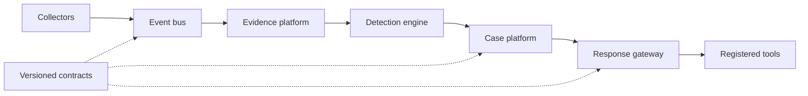

# P05 — Composable SOC platform

**Stage:** reference architecture; not a tested deployment.

## When to consider it

Teams owning modular collectors, queues, analytics, case and response components.

## Logical arrangement

Components exchange versioned data, identity and authority contracts.

Arrows identify intended relationships. They are not packet observations, provider deployment evidence or proof of isolation.

## Trade-off

Flexibility requires integration, patch, support and recovery ownership.

## Pattern-specific design constraints

| ID | Decision to make | Failure to avoid | Acceptance evidence |
|---|---|---|---|
| P05-C01 | Own every component and interface lifecycle. | Modularity is assumed to be operationally free. | Ownership register and patch/recovery plan. |
| P05-C02 | Validate identity, schema, retries and time semantics at interfaces. | Successful transport is mistaken for interoperability. | Contract and negative cases per component pair. |
| P05-C03 | Control plugin admission and privileged automation. | Convenient integrations gain unreviewed execution rights. | Admission and permission-change review. |
| P05-C04 | Observe end-to-end behavior and failure propagation. | Healthy individual tools leave a broken workflow. | Source-to-case/action and induced interface failures. |

## Priority layer reviews

[L05](../layers/l05-ingestion-and-streaming.md) · [L18](../layers/l18-platform-security-and-change.md) · [L23](../layers/l23-interoperability-and-migration.md) · [L24](../layers/l24-assurance-and-acceptance.md)

All 24 layers remain in the review scope. These links highlight decisions that change most for this pattern; they do not exempt other controls.

## Environment-specific gate

Before implementation, agree the business scope, approved sources, authority boundaries, data/administrator/key/support/recovery placement, critical dependencies and response rights. Verify actual source delivery, permission boundaries, failure behavior, cost/capacity and restoration in the intended environment. Mixed patterns need an interface and responsibility review at every joining boundary.

[Pattern catalog](../../docs/pattern-index.md) · [Selection method](../../docs/architecture-selection.md) · [Acceptance record](../../templates/acceptance-record.md).
