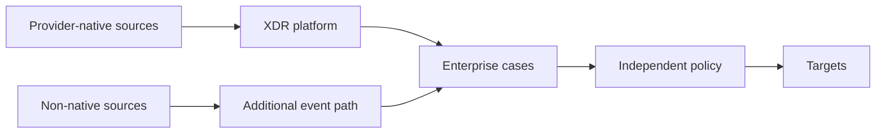

# P06 — XDR-led SOC

**Stage:** reference architecture; not a tested deployment.

## When to consider it

An estate relying heavily on provider-native endpoint, identity or network analytics.

## Logical arrangement

XDR evidence joins non-native sources and an enterprise case/decision layer.

Arrows identify intended relationships. They are not packet observations, provider deployment evidence or proof of isolation.

## Trade-off

Quick integration can coexist with proprietary logic and raw-evidence limits.

## Pattern-specific design constraints

| ID | Decision to make | Failure to avoid | Acceptance evidence |
|---|---|---|---|
| P06-C01 | Identify required sources beyond native sensors. | Provider coverage is presented as whole-enterprise coverage. | Non-native source inventory and missing-source cases. |
| P06-C02 | Separate documented analytics from tested outcomes. | Technique lists are treated as demonstrated protection. | Positive/benign/missed cases and opaque internals. |
| P06-C03 | Keep export and alternative investigation usable. | Supplier failure makes original evidence unavailable. | Raw/case export and alternative-query exercise. |
| P06-C04 | Retain enterprise approval for consequential response. | Provider recommendations authorize business disruption. | Exact resource approvals and denied unapproved containment. |

## Priority layer reviews

[L03](../layers/l03-telemetry-producers.md) · [L09](../layers/l09-detection-engineering.md) · [L11](../layers/l11-alert-triage-and-analyst-experience.md) · [L23](../layers/l23-interoperability-and-migration.md)

All 24 layers remain in the review scope. These links highlight decisions that change most for this pattern; they do not exempt other controls.

## Environment-specific gate

Before implementation, agree the business scope, approved sources, authority boundaries, data/administrator/key/support/recovery placement, critical dependencies and response rights. Verify actual source delivery, permission boundaries, failure behavior, cost/capacity and restoration in the intended environment. Mixed patterns need an interface and responsibility review at every joining boundary.

[Pattern catalog](../../docs/pattern-index.md) · [Selection method](../../docs/architecture-selection.md) · [Acceptance record](../../templates/acceptance-record.md).
