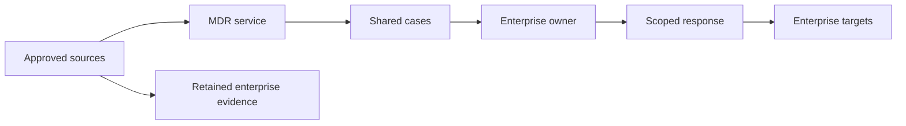

# P07 — MDR and shared-responsibility SOC

**Stage:** reference architecture; not a tested deployment.

## When to consider it

Outsourced monitoring with retained enterprise risk and action ownership.

## Logical arrangement

Provider cases reach enterprise decision owners; selected evidence remains independently retained.

Arrows identify intended relationships. They are not packet observations, provider deployment evidence or proof of isolation.

## Trade-off

Coverage and skills add access, contract, handover and supplier concentration obligations.

## Pattern-specific design constraints

| ID | Decision to make | Failure to avoid | Acceptance evidence |
|---|---|---|---|
| P07-C01 | Agree coverage, response rights, escalation and retained duties. | An MDR contract implies a complete enterprise mandate. | RACI, commitments and joint handover exercise. |
| P07-C02 | Limit supplier permissions by resource, tenant and purpose. | Convenience grants unrestricted administration. | Access review and foreign-resource denials. |
| P07-C03 | Maintain evidence, continuity and exit rights. | Supplier failure removes monitoring and investigation. | Retained data and alternate-operating procedure. |
| P07-C04 | Validate joint command and notification responsibility. | Supplier and enterprise act inconsistently or leave obligations unowned. | Joint exercise with responsible legal/service owners. |

## Priority layer reviews

[L01](../layers/l01-mission-and-operating-model.md) · [L12](../layers/l12-investigation-forensics-and-cases.md) · [L13](../layers/l13-response-orchestration.md) · [L20](../layers/l20-privacy-sovereignty-and-governance.md)

All 24 layers remain in the review scope. These links highlight decisions that change most for this pattern; they do not exempt other controls.

## Environment-specific gate

Before implementation, agree the business scope, approved sources, authority boundaries, data/administrator/key/support/recovery placement, critical dependencies and response rights. Verify actual source delivery, permission boundaries, failure behavior, cost/capacity and restoration in the intended environment. Mixed patterns need an interface and responsibility review at every joining boundary.

[Pattern catalog](../../docs/pattern-index.md) · [Selection method](../../docs/architecture-selection.md) · [Acceptance record](../../templates/acceptance-record.md).
