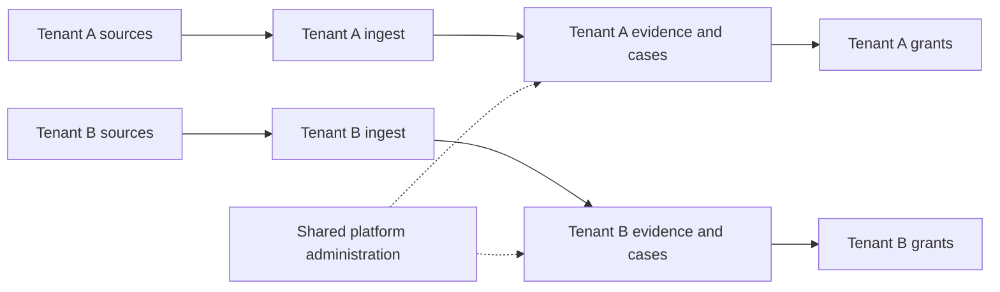

# P08 — MSSP multi-tenant SOC

**Stage:** reference architecture; not a tested deployment.

## When to consider it

A provider serving separately authorized customers.

## Logical arrangement

Tenant-qualified ingest, storage, cases, quotas and grants share selected infrastructure.

Arrows identify intended relationships. They are not packet observations, provider deployment evidence or proof of isolation.

## Trade-off

Shared efficiency increases isolation, admin and noisy-neighbor risks.

## Pattern-specific design constraints

| ID | Decision to make | Failure to avoid | Acceptance evidence |
|---|---|---|---|
| P08-C01 | Enforce tenant isolation below consoles, caches, queues and stores. | UI labels are the only separation. | Cross-tenant read/write/cache/export denials. |
| P08-C02 | Separate customer keys, grants and approval owners. | Shared approval acts across unrelated customers. | Key/grant custody and mismatched-tenant denial. |
| P08-C03 | Protect per-tenant capacity and expose visibility loss. | One tenant exhausts shared capacity or hides dropped evidence. | Burst/isolation tests and tenant loss accounting. |
| P08-C04 | Authorize analyst assignment and supplier support per customer. | Global staffing automatically inherits all tenant rights. | Assignment, expiry and controlled case-sharing checks. |

## Priority layer reviews

[L05](../layers/l05-ingestion-and-streaming.md) · [L07](../layers/l07-data-platform-and-retention.md) · [L13](../layers/l13-response-orchestration.md) · [L17](../layers/l17-soc-identity-and-privileged-access.md)

All 24 layers remain in the review scope. These links highlight decisions that change most for this pattern; they do not exempt other controls.

## Environment-specific gate

Before implementation, agree the business scope, approved sources, authority boundaries, data/administrator/key/support/recovery placement, critical dependencies and response rights. Verify actual source delivery, permission boundaries, failure behavior, cost/capacity and restoration in the intended environment. Mixed patterns need an interface and responsibility review at every joining boundary.

[Pattern catalog](../../docs/pattern-index.md) · [Selection method](../../docs/architecture-selection.md) · [Acceptance record](../../templates/acceptance-record.md).
