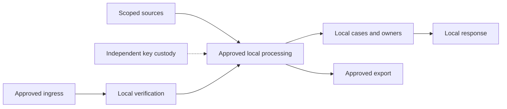

# P10 — Sovereign connected SOC

**Stage:** reference architecture; not a tested deployment.

## When to consider it

Explicit jurisdiction, operator, key and supplier boundaries with connectivity.

## Logical arrangement

Approved local processing and keys use governed external feeds, support and exports.

Arrows identify intended relationships. They are not packet observations, provider deployment evidence or proof of isolation.

## Trade-off

Connectivity must not obscure external authority and disclosure obligations.

## Pattern-specific design constraints

| ID | Decision to make | Failure to avoid | Acceptance evidence |
|---|---|---|---|
| P10-C01 | Define data, administrator, key, support, supplier and recovery authority separately. | Location is reported as proven sovereignty. | Declaration/observation/contract boundary register. |
| P10-C02 | Constrain feeds, support and exits by purpose and recipient. | Support or analytics creates uncontrolled disclosure. | Permitted/denied transfer and support cases. |
| P10-C03 | Restore within the required authority and placement scope. | Recovery relies on unapproved foreign operators or copies. | Scoped restore and independently reviewed placement. |
| P10-C04 | Separate connectivity from sovereignty assurance. | Disconnection is assumed to establish sovereignty. | Independent connectivity and authority acceptance records. |

## Priority layer reviews

[L17](../layers/l17-soc-identity-and-privileged-access.md) · [L19](../layers/l19-resilience-and-disaster-recovery.md) · [L20](../layers/l20-privacy-sovereignty-and-governance.md) · [L24](../layers/l24-assurance-and-acceptance.md)

All 24 layers remain in the review scope. These links highlight decisions that change most for this pattern; they do not exempt other controls.

## Environment-specific gate

Before implementation, agree the business scope, approved sources, authority boundaries, data/administrator/key/support/recovery placement, critical dependencies and response rights. Verify actual source delivery, permission boundaries, failure behavior, cost/capacity and restoration in the intended environment. Mixed patterns need an interface and responsibility review at every joining boundary.

[Pattern catalog](../../docs/pattern-index.md) · [Selection method](../../docs/architecture-selection.md) · [Acceptance record](../../templates/acceptance-record.md).
