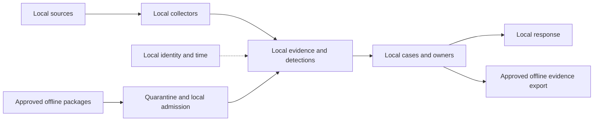

# P11 — Strictly disconnected SOC

**Stage:** reference architecture; not a tested deployment.

## When to consider it

Local monitoring and response requiring no routine external connectivity.

## Logical arrangement

Local collection, identity, time, keys, analytics and response operate within the site; approved media/transfer procedures admit updates or export evidence.

Arrows identify intended relationships. They are not packet observations, provider deployment evidence or proof of isolation.

## Trade-off

Local autonomy brings local lifecycle, intelligence age, admission, staffing and recovery burdens.

## Pattern-specific design constraints

| ID | Decision to make | Failure to avoid | Acceptance evidence |
|---|---|---|---|
| P11-C01 | Remove or provide local alternatives for critical external runtime dependencies. | Cloud identity, DNS, time, licensing or certificate checks stop local operations. | Disconnected dependency inventory and measured unavailable-service cases. |
| P11-C02 | Verify physical transfer, content integrity and approval as separate controls. | A signed package is assumed safe or an air-gap diagram is assumed enforced. | Media custody, artifact/target checks and independently reviewed transfer enforcement. |
| P11-C03 | Operate local freshness, revocation and emergency authority deliberately. | Stale grants or intelligence create unbounded local permissions. | Age/expiry/revocation exercises and retained decision owners. |
| P11-C04 | Maintain local restoration and tested clean recovery. | Evidence and keys require unreachable central services. | Clean-target restore with measured loss and remaining dependencies. |

## Priority layer reviews

[L04](../layers/l04-edge-collection-and-buffering.md) · [L17](../layers/l17-soc-identity-and-privileged-access.md) · [L18](../layers/l18-platform-security-and-change.md) · [L19](../layers/l19-resilience-and-disaster-recovery.md)

All 24 layers remain in the review scope. These links highlight decisions that change most for this pattern; they do not exempt other controls.

## Environment-specific gate

Before implementation, agree the business scope, approved sources, authority boundaries, data/administrator/key/support/recovery placement, critical dependencies and response rights. Verify actual source delivery, permission boundaries, failure behavior, cost/capacity and restoration in the intended environment. Mixed patterns need an interface and responsibility review at every joining boundary.

[Pattern catalog](../../docs/pattern-index.md) · [Selection method](../../docs/architecture-selection.md) · [Acceptance record](../../templates/acceptance-record.md).
