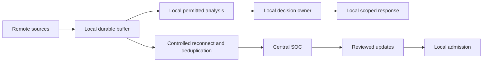

# P12 — Intermittent edge and remote-site SOC

**Stage:** reference architecture; not a tested deployment.

## When to consider it

Remote sites that temporarily lose central connectivity.

## Logical arrangement

Local queues and permitted analysis/response remain available; resynchronization exports bounded data with freshness and deduplication.

Arrows identify intended relationships. They are not packet observations, provider deployment evidence or proof of isolation.

## Trade-off

Continuity depends on outage assumptions, local authority and safe reconciliation.

## Pattern-specific design constraints

| ID | Decision to make | Failure to avoid | Acceptance evidence |
|---|---|---|---|
| P12-C01 | Size durable buffers against explicit outage and burst assumptions. | Unmodeled outages cause silent loss or unsafe full-disk behavior. | Restart/full-buffer trials and overflow/loss policy. |
| P12-C02 | Bound local actions independently of central availability. | Lost connectivity grants unrestricted emergency response. | Local grant/expiry and denied escalation cases. |
| P12-C03 | Report delayed, missing or unverified site evidence centrally. | Last received telemetry is displayed as current. | Report-aging cases and clear visibility status. |
| P12-C04 | Reconcile duplicate events, cases, updates and action receipts on reconnect. | Repeated data or stale approvals duplicate actions. | Resynchronization and authority-state replay tests. |

## Priority layer reviews

[L04](../layers/l04-edge-collection-and-buffering.md) · [L05](../layers/l05-ingestion-and-streaming.md) · [L13](../layers/l13-response-orchestration.md) · [L21](../layers/l21-observability-and-effectiveness.md)

All 24 layers remain in the review scope. These links highlight decisions that change most for this pattern; they do not exempt other controls.

## Environment-specific gate

Before implementation, agree the business scope, approved sources, authority boundaries, data/administrator/key/support/recovery placement, critical dependencies and response rights. Verify actual source delivery, permission boundaries, failure behavior, cost/capacity and restoration in the intended environment. Mixed patterns need an interface and responsibility review at every joining boundary.

[Pattern catalog](../../docs/pattern-index.md) · [Selection method](../../docs/architecture-selection.md) · [Acceptance record](../../templates/acceptance-record.md).
