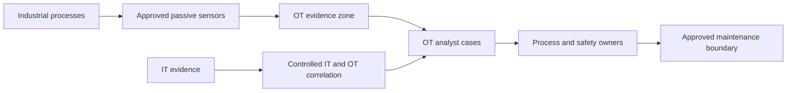

# P13 — OT and industrial SOC

**Stage:** reference architecture; not a tested deployment.

## When to consider it

Industrial operations with process safety, legacy equipment and strict change windows.

## Logical arrangement

Approved passive sensors feed an OT evidence zone; process owners govern maintenance and containment decisions.

Arrows identify intended relationships. They are not packet observations, provider deployment evidence or proof of isolation.

## Trade-off

Better visibility must respect safety, availability, protocol limits and engineering authority.

## Pattern-specific design constraints

| ID | Decision to make | Failure to avoid | Acceptance evidence |
|---|---|---|---|
| P13-C01 | Approve passive/active collection and testing with process owners. | Security scans or sensor changes disrupt operations. | Safety review, approved method and bounded operating window. |
| P13-C02 | Separate OT and IT control/identity domains and permitted correlation. | IT compromise gains engineering command authority. | Zone/action matrix and denied cross-domain commands. |
| P13-C03 | Keep containment under engineering/safety authority. | Automatic isolation harms physical processes. | Consequential-action approval and safe alternate-response exercise. |
| P13-C04 | Plan local maintenance, updates and recovery for legacy dependencies. | Unsupported or externally dependent tooling breaks remote-site operation. | Lifecycle dependency and locally recoverable operating plan. |

## Priority layer reviews

[L03](../layers/l03-telemetry-producers.md) · [L15](../layers/l15-hunting-and-adversary-validation.md) · [L16](../layers/l16-incident-command-and-recovery.md) · [L20](../layers/l20-privacy-sovereignty-and-governance.md)

All 24 layers remain in the review scope. These links highlight decisions that change most for this pattern; they do not exempt other controls.

## Environment-specific gate

Before implementation, agree the business scope, approved sources, authority boundaries, data/administrator/key/support/recovery placement, critical dependencies and response rights. Verify actual source delivery, permission boundaries, failure behavior, cost/capacity and restoration in the intended environment. Mixed patterns need an interface and responsibility review at every joining boundary.

[Pattern catalog](../../docs/pattern-index.md) · [Selection method](../../docs/architecture-selection.md) · [Acceptance record](../../templates/acceptance-record.md).
