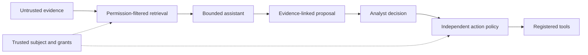

# P14 — AI-assisted human-led SOC

**Stage:** reference architecture; not a tested deployment.

## When to consider it

Teams using AI for evidence summaries, query assistance and investigation support.

## Logical arrangement

Authorized context reaches a bounded assistant; analysts accept conclusions and independently authorized tools execute permitted actions.

Arrows identify intended relationships. They are not packet observations, provider deployment evidence or proof of isolation.

## Trade-off

Assistance adds instruction, retrieval, provider, model-update and confidence risks.

## Pattern-specific design constraints

| ID | Decision to make | Failure to avoid | Acceptance evidence |
|---|---|---|---|
| P14-C01 | Authorize retrieval before data enters model context. | An unauthorized document is exposed before redaction. | Mixed-tenant/field retrieval and legitimate-context controls. |
| P14-C02 | Keep evidence text and model output outside the authority path. | Prompt injection or fabricated approval grants a tool action. | Instruction/approval-forgery cases and independent tool decisions. |
| P14-C03 | Review provider data, placement, retention and fallback. | A helpful summary sends confidential evidence to an unapproved service. | Allowed/denied provider routes and unavailable-model behavior. |
| P14-C04 | Evaluate outputs and admit changes with known limits. | An impressive demo becomes an assurance claim about real-model quality. | Task-specific factuality/usefulness tests, uncertainty and versioned re-evaluation. |

## Priority layer reviews

[L10](../layers/l10-analytics-and-ueba.md) · [L11](../layers/l11-alert-triage-and-analyst-experience.md) · [L13](../layers/l13-response-orchestration.md) · [L14](../layers/l14-ai-copilots-and-agents.md)

All 24 layers remain in the review scope. These links highlight decisions that change most for this pattern; they do not exempt other controls.

## Environment-specific gate

Before implementation, agree the business scope, approved sources, authority boundaries, data/administrator/key/support/recovery placement, critical dependencies and response rights. Verify actual source delivery, permission boundaries, failure behavior, cost/capacity and restoration in the intended environment. Mixed patterns need an interface and responsibility review at every joining boundary.

[Pattern catalog](../../docs/pattern-index.md) · [Selection method](../../docs/architecture-selection.md) · [Acceptance record](../../templates/acceptance-record.md).
