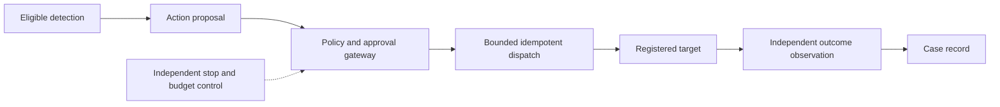

# P15 — Bounded closed-loop automation

**Stage:** reference architecture; not a tested deployment.

## When to consider it

Low-impact or tightly governed repeatable actions with measurable permitted outcomes.

## Logical arrangement

Eligible events propose actions; independent policy applies scope, budget, approval and idempotency before dispatch and verification.

Arrows identify intended relationships. They are not packet observations, provider deployment evidence or proof of isolation.

## Trade-off

Speed increases the cost of policy mistakes, stale inputs, duplicated execution and partial failures.

## Pattern-specific design constraints

| ID | Decision to make | Failure to avoid | Acceptance evidence |
|---|---|---|---|
| P15-C01 | Limit eligible actions, resources, rate and blast radius. | One noisy or compromised detection disrupts an entire estate. | Wrong-resource and over-budget negative cases. |
| P15-C02 | Require exact approvals and fresh independent context for high-impact actions. | Automation bypasses business authority. | Expired/mismatched/replayed approval cases. |
| P15-C03 | Observe real target state and retain partial or failed outcomes. | Success messages are treated as verified containment. | Independent state check and interrupted/partial-effect evidence. |
| P15-C04 | Test retry, stop and compensation with explicit irreversibility. | Rollback promises exceed what an action can reverse. | Duplicate/interrupted action trials and owned residual decisions. |

## Priority layer reviews

[L09](../layers/l09-detection-engineering.md) · [L13](../layers/l13-response-orchestration.md) · [L17](../layers/l17-soc-identity-and-privileged-access.md) · [L21](../layers/l21-observability-and-effectiveness.md)

All 24 layers remain in the review scope. These links highlight decisions that change most for this pattern; they do not exempt other controls.

## Environment-specific gate

Before implementation, agree the business scope, approved sources, authority boundaries, data/administrator/key/support/recovery placement, critical dependencies and response rights. Verify actual source delivery, permission boundaries, failure behavior, cost/capacity and restoration in the intended environment. Mixed patterns need an interface and responsibility review at every joining boundary.

[Pattern catalog](../../docs/pattern-index.md) · [Selection method](../../docs/architecture-selection.md) · [Acceptance record](../../templates/acceptance-record.md).
