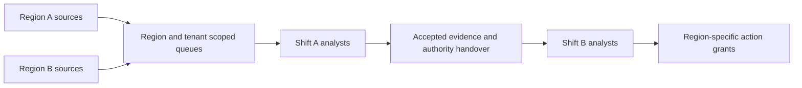

# P16 — Follow-the-sun global SOC

**Stage:** reference architecture; not a tested deployment.

## When to consider it

Distributed analyst teams sharing approved workload across time zones.

## Logical arrangement

Region/tenant-scoped queues and evidence support a documented handover with authority expiry and accepted ownership.

Arrows identify intended relationships. They are not packet observations, provider deployment evidence or proof of isolation.

## Trade-off

Coverage depends on lawful access, staffing, fatigue, context continuity and actual acknowledgement.

## Pattern-specific design constraints

| ID | Decision to make | Failure to avoid | Acceptance evidence |
|---|---|---|---|
| P16-C01 | Authorize staffing assignments and data access per region and customer. | Global coverage becomes unrestricted cross-border evidence access. | Assignment/access review and denied foreign-scope cases. |
| P16-C02 | Transfer ownership, evidence status and pending approvals explicitly. | A case is sent but not accepted by the next shift. | Acknowledged handover with unresolved decisions and timers. |
| P16-C03 | Model workload, leave, specialist availability and surge capacity. | Nominal time-zone coverage is treated as adequate incident capacity. | Rota and workload model followed by observed shift performance. |
| P16-C04 | Expire grants and reconcile concurrent shift actions. | Old and new shifts both act using stale approval. | Expiry, duplicate-action and ownership-switch cases. |

## Priority layer reviews

[L01](../layers/l01-mission-and-operating-model.md) · [L11](../layers/l11-alert-triage-and-analyst-experience.md) · [L12](../layers/l12-investigation-forensics-and-cases.md) · [L22](../layers/l22-capacity-cost-and-staffing.md)

All 24 layers remain in the review scope. These links highlight decisions that change most for this pattern; they do not exempt other controls.

## Environment-specific gate

Before implementation, agree the business scope, approved sources, authority boundaries, data/administrator/key/support/recovery placement, critical dependencies and response rights. Verify actual source delivery, permission boundaries, failure behavior, cost/capacity and restoration in the intended environment. Mixed patterns need an interface and responsibility review at every joining boundary.

[Pattern catalog](../../docs/pattern-index.md) · [Selection method](../../docs/architecture-selection.md) · [Acceptance record](../../templates/acceptance-record.md).
