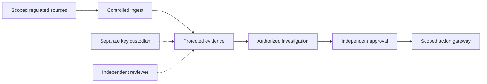

# P17 — Regulated and high-assurance SOC

**Stage:** reference architecture; not a tested deployment.

## When to consider it

Services requiring strong traceability, constrained privileges and independently reviewable evidence.

## Logical arrangement

Separated collection, analysis, evidence custody, key ownership and action approval support a scoped assurance process.

Arrows identify intended relationships. They are not packet observations, provider deployment evidence or proof of isolation.

## Trade-off

Higher assurance increases evidence, operational separation and change-management effort.

## Pattern-specific design constraints

| ID | Decision to make | Failure to avoid | Acceptance evidence |
|---|---|---|---|
| P17-C01 | Establish applicable entity/sector/jurisdiction obligations before mapping. | A generic standards crosswalk is called certified compliance. | Owner-reviewed applicability and source/version record. |
| P17-C02 | Separate evidence custody, key ownership, approval and routine operations. | One administrator can act and erase accountability. | Duty separation and privileged-operation observations. |
| P17-C03 | Document custody, uncertainty and completeness limitations. | Hashes are claimed to prove trustworthy time or complete evidence. | Tamper/gap/time tests and independent anchoring gaps. |
| P17-C04 | Admit changes and exceptions through owned evidence gates. | Urgency creates indefinite unreviewed bypasses. | Change/exception expiry and reviewer acceptance. |

## Priority layer reviews

[L12](../layers/l12-investigation-forensics-and-cases.md) · [L17](../layers/l17-soc-identity-and-privileged-access.md) · [L20](../layers/l20-privacy-sovereignty-and-governance.md) · [L24](../layers/l24-assurance-and-acceptance.md)

All 24 layers remain in the review scope. These links highlight decisions that change most for this pattern; they do not exempt other controls.

## Environment-specific gate

Before implementation, agree the business scope, approved sources, authority boundaries, data/administrator/key/support/recovery placement, critical dependencies and response rights. Verify actual source delivery, permission boundaries, failure behavior, cost/capacity and restoration in the intended environment. Mixed patterns need an interface and responsibility review at every joining boundary.

[Pattern catalog](../../docs/pattern-index.md) · [Selection method](../../docs/architecture-selection.md) · [Acceptance record](../../templates/acceptance-record.md).
