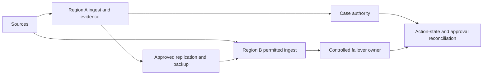

# P18 — Multi-region recovery SOC

**Stage:** reference architecture; not a tested deployment.

## When to consider it

Services needing defined continuity across permitted regional failure domains.

## Logical arrangement

Regional collection/data/case services replicate within approved boundaries; response authority and failback ownership are separately controlled.

Arrows identify intended relationships. They are not packet observations, provider deployment evidence or proof of isolation.

## Trade-off

Availability can conflict with placement, authority, replication cost and consistent action state.

## Pattern-specific design constraints

| ID | Decision to make | Failure to avoid | Acceptance evidence |
|---|---|---|---|
| P18-C01 | Choose regions, dependencies and quorum within allowed boundaries. | Redundancy violates placement or still shares one critical dependency. | Failure-domain and authority/placement review. |
| P18-C02 | Define partition behavior and freshness-sensitive response. | A region acts on stale context or creates split-brain decisions. | Partition exercise and explicit degraded action modes. |
| P18-C03 | Restore evidence and authorization/action state together. | Recovered approvals permit stale or repeated actions. | RPO/RTO measurement and replay-state restoration cases. |
| P18-C04 | Verify failback, duplicate handling and owned reconciliation. | Returning regions overwrite cases or repeat containment. | Failure/failback exercise with observed records and residual gaps. |

## Priority layer reviews

[L05](../layers/l05-ingestion-and-streaming.md) · [L13](../layers/l13-response-orchestration.md) · [L19](../layers/l19-resilience-and-disaster-recovery.md) · [L20](../layers/l20-privacy-sovereignty-and-governance.md)

All 24 layers remain in the review scope. These links highlight decisions that change most for this pattern; they do not exempt other controls.

## Environment-specific gate

Before implementation, agree the business scope, approved sources, authority boundaries, data/administrator/key/support/recovery placement, critical dependencies and response rights. Verify actual source delivery, permission boundaries, failure behavior, cost/capacity and restoration in the intended environment. Mixed patterns need an interface and responsibility review at every joining boundary.

[Pattern catalog](../../docs/pattern-index.md) · [Selection method](../../docs/architecture-selection.md) · [Acceptance record](../../templates/acceptance-record.md).
