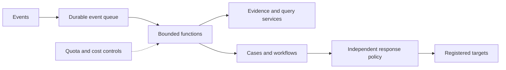

# P19 — Serverless and elastic SOC

**Stage:** reference architecture; not a tested deployment.

## When to consider it

Bursty workloads where managed event, query and workflow services are suitable.

## Logical arrangement

Event triggers route to durable evidence and bounded analytics/workflows; independent authority checks precede response.

Arrows identify intended relationships. They are not packet observations, provider deployment evidence or proof of isolation.

## Trade-off

Elasticity remains constrained by quotas, cold starts, API rates, state and cost.

## Pattern-specific design constraints

| ID | Decision to make | Failure to avoid | Acceptance evidence |
|---|---|---|---|
| P19-C01 | Model throttling, cold start, concurrency and finite retries. | Elastic services are assumed to have unlimited timely capacity. | Burst/throttle/retry measurements and backlog ownership. |
| P19-C02 | Use durable checkpoints and idempotency for repeated events. | Short-lived workers duplicate cases or actions. | Worker interruption/replay and partial-effect cases. |
| P19-C03 | Scope function identities and protect configuration admission. | An event function acquires broad query and response privileges. | Per-function grants and untrusted-change cases. |
| P19-C04 | Bound query, execution, egress and model spend. | A hostile source creates a financially unbounded workflow. | Cost/rate budgets and overload/degraded behavior. |

## Priority layer reviews

[L05](../layers/l05-ingestion-and-streaming.md) · [L13](../layers/l13-response-orchestration.md) · [L19](../layers/l19-resilience-and-disaster-recovery.md) · [L22](../layers/l22-capacity-cost-and-staffing.md)

All 24 layers remain in the review scope. These links highlight decisions that change most for this pattern; they do not exempt other controls.

## Environment-specific gate

Before implementation, agree the business scope, approved sources, authority boundaries, data/administrator/key/support/recovery placement, critical dependencies and response rights. Verify actual source delivery, permission boundaries, failure behavior, cost/capacity and restoration in the intended environment. Mixed patterns need an interface and responsibility review at every joining boundary.

[Pattern catalog](../../docs/pattern-index.md) · [Selection method](../../docs/architecture-selection.md) · [Acceptance record](../../templates/acceptance-record.md).
