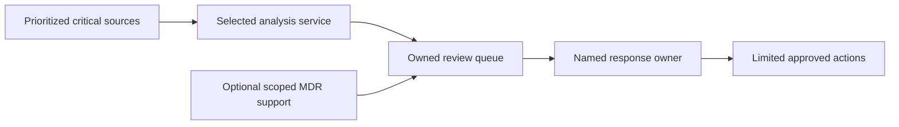

# P20 — Small-team and resource-constrained SOC

**Stage:** reference architecture; not a tested deployment.

## When to consider it

An organization prioritizing essential visibility and accountable response within explicit staffing limits.

## Logical arrangement

A small governed source set feeds managed/composable analysis, a case queue and retained decision owners with clearly defined coverage.

Arrows identify intended relationships. They are not packet observations, provider deployment evidence or proof of isolation.

## Trade-off

Focus and outsourcing can help but do not create unstaffed coverage or universal detection.

## Pattern-specific design constraints

| ID | Decision to make | Failure to avoid | Acceptance evidence |
|---|---|---|---|
| P20-C01 | Prioritize critical sources and disclose excluded visibility. | A compact toolset is marketed as complete enterprise coverage. | Business-priority/source map with exclusions and gaps. |
| P20-C02 | State collection, staffed and on-call hours separately. | An unattended queue is represented as round-the-clock response. | Actual coverage and escalation exercise. |
| P20-C03 | Bound automation to accepted low-impact scopes and clear approvals. | Scarce staffing is compensated by unsafe broad automatic actions. | Allow/deny/budget and consequential-action approval cases. |
| P20-C04 | Fund lifecycle, recovery and specialist support as well as platform subscriptions. | Low license cost hides unsustainable operating requirements. | Cost/workforce assumptions and retained supplier responsibilities. |

## Priority layer reviews

[L01](../layers/l01-mission-and-operating-model.md) · [L03](../layers/l03-telemetry-producers.md) · [L11](../layers/l11-alert-triage-and-analyst-experience.md) · [L22](../layers/l22-capacity-cost-and-staffing.md)

All 24 layers remain in the review scope. These links highlight decisions that change most for this pattern; they do not exempt other controls.

## Environment-specific gate

Before implementation, agree the business scope, approved sources, authority boundaries, data/administrator/key/support/recovery placement, critical dependencies and response rights. Verify actual source delivery, permission boundaries, failure behavior, cost/capacity and restoration in the intended environment. Mixed patterns need an interface and responsibility review at every joining boundary.

[Pattern catalog](../../docs/pattern-index.md) · [Selection method](../../docs/architecture-selection.md) · [Acceptance record](../../templates/acceptance-record.md).
