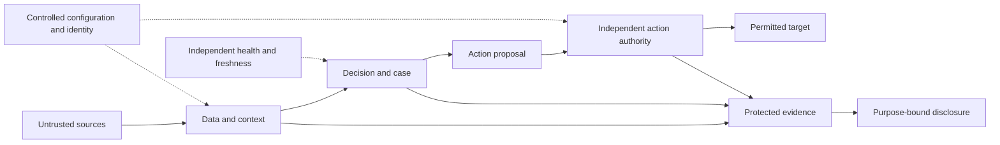

# System planes and trust boundaries

The logical planes can share physical services, but their authority and evidence responsibilities should remain explicit.

| Plane | What it handles | Trust boundary |
|---|---|---|
| Data | Event collection, buffering, ingest, normalization, stores and query | Source content is untrusted; collection rights do not grant response rights |
| Context | Identity, asset, criticality, intelligence and data classification | Provenance, tenant scope and validity must survive joins |
| Decision | Detection, analytics, AI assistance and analyst cases | A score, technique match or generated recommendation is evidence to evaluate |
| Action | Policy, approvals, dispatch and target-state observation | Independent subject/service/action/resource/tenant/purpose checks |
| Control | Configuration, content releases, identities, keys, privileges and lifecycle | A privileged update can alter every other plane; review and custody matter |
| Evidence | Originals, transformations, decisions, exports and recovery records | Integrity, disclosure, freshness and completeness are separate claims |
| Operations | Health, on-call coverage, capacity, supplier continuity and command | A healthy component is not proof of an effective end-to-end service |

## Required review boundaries

- Producer/collector: permitted data and collection privileges.
- Collector/broker: sender identity, durability, quota and replay semantics.
- Raw/normalized/query: lineage, field semantics, tenant and purpose permission.
- Query/model: authorized context and permitted provider/data exit.
- Recommendation/action: separately derived authority and exact approval.
- Action/target: finite scope, idempotency, partial outcomes and independent observation.
- Case/export: fields, recipient, classification, purpose and custody.
- Control/release: signer/target/version approval, rollback and local admission.
- Site/central: local decision rights, approved disclosure and evidence freshness.

These are intended relationships, not observed network paths. See [all layers](../docs/layer-index.md) and [threat review](threat-review.md).
