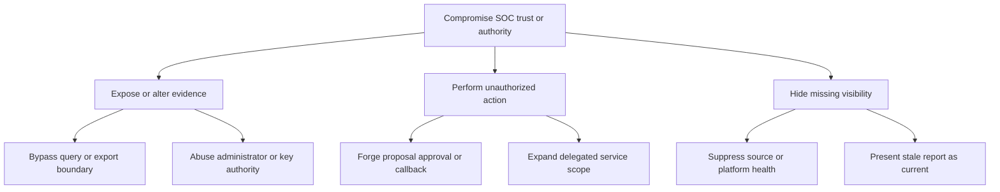

# Threat review for the SOC itself

The SOC processes attacker-controlled content and has valuable evidence and operational authority. Protecting the SOC is separate from detecting attacks against its customers.

## Actors and assets

Consider external event authors, compromised sources/collectors, malicious or compromised analysts, privileged administrators, supplier/support identities, untrusted content authors and compromised AI/tool integrations. Assets include source data, subject/tenant context, parsers, query/exports, keys, case evidence, release trust inputs, approvals and action targets.

| Misuse path | Boundary and required decision |
|---|---|
| Hostile event to parser, analyst renderer or AI prompt | Bounded parsing/rendering; content is data, not instructions or authority |
| Forged tenant/context to query/cache/case | Independently trusted subject and resource/tenant/purpose permissions |
| Powerful workload identity laundering a user request | Preserve original subject rights and explicitly limit service delegation |
| Fake indicator/enrichment URL to provider request | Provenance/confidence plus destination and cost bounds |
| Untrusted rule/model/update to privileged execution | Controlled admission, independent trust inputs and target/version ownership |
| Analyst recommendation to destructive action | Separate exact action approval, expiry, budget and outcome observation |
| Platform administrator to evidence deletion/decryption | Separate custody, key and audit/anchor responsibilities |
| Site silence or stale central report to automatic response | Visible freshness/uncertainty and bounded local authority |
| Shared infrastructure to cross-customer data/actions | Enforced isolation below consoles, stores, caches and dispatch |
| Backup/failover to restored stale permissions or replay | Recovery includes identity/approval/replay/authority state and explicit loss |

The tree is an original hypothesis set. It is not an observed attack dataset or complete adversary model. Use [failure experiments](../docs/failure-catalog.md) to turn hypotheses into authorized testable cases.
